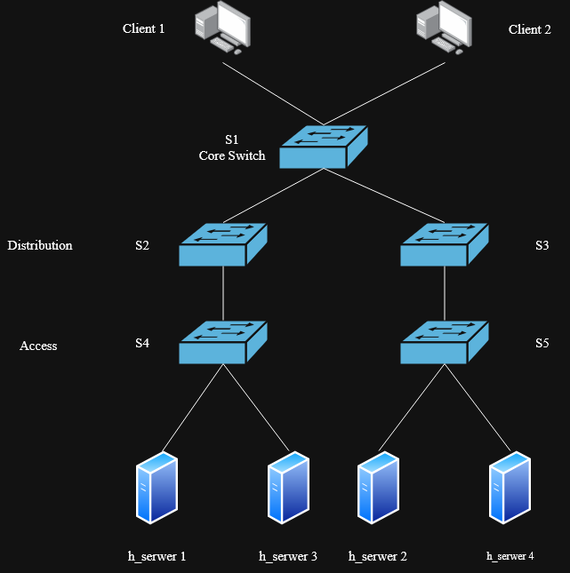

# HTTP(S) Resource-aware Load Balancer

## Źródła:
- **ERA: Efficient Request Assignment**  
  Sterownik utrzymuje tablicę stanu serwerów (opóżnienie przetwarzania zapytań, wykorzystanie CPU i RAM, łączny czas odpowiedzi na zapytania)
  Przy otrzymaniu żądania sterownik najpierw odrzuca serwery, które nie mają wystarczających zasobów do obsługi żądania. Następnie na podstawie ważonej oceny uwzględniających opóźnienie i wykorzystanie zasobów przydziela zapytanie do najmniej obciążonego serwera.  
  **Źródło:** Y. -C. Wang and J. -F. Zhang, "ERA: Efficient Request Assignment for Servers in Data Center Networks with SDN," 2023 IEEE 20th International Conference on Smart Communities: Improving Quality of Life using AI, Robotics and IoT (HONET), Boca Raton, FL, USA, 2023, pp. 24-29, doi: [10.1109/HONET59747.2023.10374886](https://doi.org/10.1109/HONET59747.2023.10374886).
- **ABC: Artificial Bee Colony**  
  Sterownik dla każdego serwera przechowuje wskaźnik obciążenia (Liczba obsługiwanych zadań/zasoby). Na tej podstawie obliczana jest funkcja dostosowania: 1/(1+load)
  Zapytania są rozdzielane za pomocą selekcji ruletkowej na podstawie funkcji dostosowania.  
  **Źródło:** Y. Yang and G. Yi, "Research on Dynamic Load Balancing Based on Artificial Bee Colony Algorithm," 2024 7th International Conference on Mechatronics, Robotics and Automation (ICMRA), Wuhan, China, 2024, pp. 197-200, doi: [10.1109/ICMRA62519.2024.10809037](https://doi.org/10.1109/ICMRA62519.2024.10809037).

## Topologia sieci

Sieć została zaprojektowana w oparciu o trójwarstwową architekturę hierarchiczną, składającą się z warstwy rdzeniowej (Core – S1), dystrybucyjnej (Distribution – S2, S3) oraz dostępowej (Access – S4, S5). Do przełącznika rdzeniowego podłączono dwóch klientów, natomiast serwery komunikują się z siecią za pośrednictwem przełączników warstwy dostępowej.

